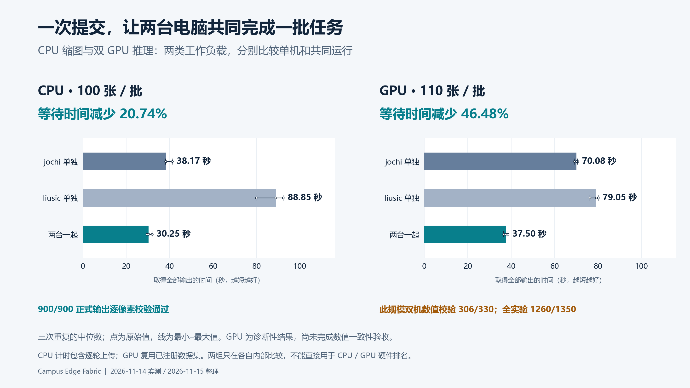
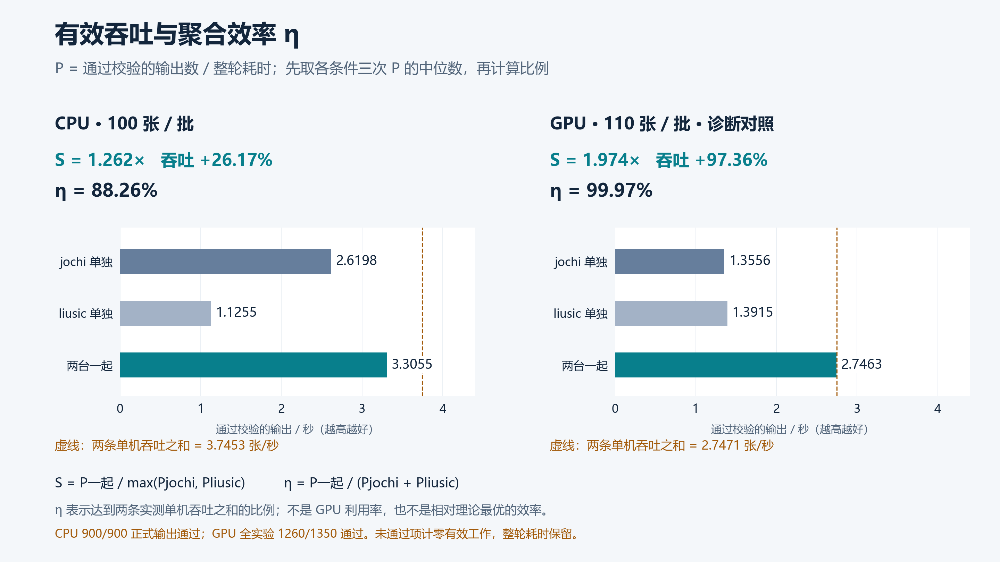

# 演示数据与结论（2026-11-15）

建议用一句话贯穿：**小组里一个人提交一批任务，系统把任务分配给已接入的电脑，最后统一拿到结果。** 本次分别用 CPU 缩图和 GPU 推理验证这条流程。以下均为 2026-11-14 的历史实测，不是当前在线状态。

## 直接放进 pre 的数据

| 工作负载 | jochi 单独 | liusic 单独 | 两台一起 | 相对耗时较短单机的等待时间减少 | 输出质量 |
| --- | ---: | ---: | ---: | ---: | --- |
| CPU 缩图：100 张/批 | 38.17 秒 | 88.85 秒 | 30.25 秒 | **20.74%** | 全部正式输出 **900/900** 逐像素通过 |
| 双 GPU 推理：110 张/批 | 70.08 秒 | 79.05 秒 | 37.50 秒 | **46.48%** | 此规模双机 **306/330** 数值通过；全实验 **1260/1350** |

每格为同一输入批次运行三次的中位数，不取最快一轮。CPU 的 900 个输出来自 100 张不同原图在九轮中复用；GPU 的 1350 个输出来自 110 张不同原图及其 8/32 张子集在 27 轮中复用。

独立页面：[CPU 对比图](01-cpu.png)、[双 GPU 对比图](02-gpu.png)。同名 SVG 可缩放，PNG 可直接放入幻灯片。点是三次原始值，误差线是最小–最大值，不是置信区间。

**口径不能混用：**CPU 包含每轮输入上传；GPU 从已注册数据集提交作业开始计时，不含首次上传；两者均包含调度和结果下载，不计本地参考校验。只在各自实验内部比较。CPU 的有效吞吐提高 26.17%，对应等待时间减少 20.74%，两种百分比不是同一个指标。

## 吞吐量、提升比例 S 与聚合效率 η

有效吞吐 P = 通过校验的输出数 ÷ 整轮耗时。每轮先算 P，再取各条件三次的中位数。GPU 未通过固定数值参考的输出不算有效工作，但其执行时间仍保留在分母中。

| 工作负载 | jochi 张/秒 | liusic 张/秒 | 一起张/秒 | S：相对较高单机吞吐 | 吞吐提升 | η：聚合效率 |
| --- | ---: | ---: | ---: | ---: | ---: | ---: |
| CPU · 100 张 | 2.6198 | 1.1255 | 3.3055 | 1.262× | +26.17% | 88.26% |
| GPU · 8 张 | 1.4211 | 1.0997 | 1.9451 | 1.369× | +36.87% | 77.16% |
| GPU · 32 张 | 1.2680 | 1.3400 | 2.4049 | 1.795× | +79.47% | 92.21% |
| GPU · 110 张 | 1.3556 | 1.3915 | 2.7463 | 1.974× | +97.36% | 99.97% |

- **S = P一起 / max(Pjochi, Pliusic)**：共同运行的有效吞吐是较高单机的多少倍；提升百分比为 (S−1)×100%。
- **η = P一起 / (Pjochi + Pliusic)**：共同运行的有效吞吐达到两条单机实测吞吐之和的多少。

CPU：3.3055 / (2.6198 + 1.1255) = **88.26%**。
GPU 110 张：2.7463 / (1.3556 + 1.3915) = **99.97%**。表格值经四舍五入，正式比例用未舍入值计算。

**η 的分母是经验参照，不是理论最优上限。** η 接近 100% 只表示本次双机有效吞吐接近两条单机实测值之和；不能解释成 GPU 利用率 100%、无系统开销、最优调度或无限扩展。单机与双机是不同轮次，且仅各重复三次；网络、轮询、任务分配和数值通过数量都会影响这个比值。GPU 的不同规模 η 随批量变大而提高，是本次观察，需更大规模与重复测量验证。

GPU 110 张的 S=1.974× 与等待时间比例 70.08/37.50 不同：前者按通过数值参考的输出计算，后者计取得全部返回结果的时间；前者最佳单机是 liusic，后者耗时较短单机是 jochi。不要把两种口径混成一个“加速比”。

可在 pre 补一句：**CPU 的共同处理有效吞吐比最佳单机提高 26.17%，达到两条单机吞吐之和的 88.26%；GPU 110 张诊断对照分别为 97.36% 和 99.97%，仍需完成数值一致性复验。**

## 最适合展示什么

1. **流程：**打开真实历史输出和来源记录，说明一份作业里确实有两台 Worker 的结果，最终统一下载。GPU 的 8 张样例来自完整的一次 pool 作业，两台各返回 4 张且全部通过参考。
2. **性能：**用上面的 100 张 CPU / 110 张 GPU 对比图。CPU 是已通过本次输出正确性检查的证据；GPU 是包含数值差异的诊断对照，说明等待时间和校验结果即可。
3. **产品范围：**当前已实测两类预先支持的批任务。可以扩展其他适配器；本次尚未证明任意 GPU 程序都能运行，也没有 Blender 实测结果。

CPU pool 的三轮都有两台参与；首轮 jochi/liusic 分别返回 76/24 个通过输出。GPU 的九轮 pool 都有两台贡献通过输出。固定分工不必平均：不同机器可以接走不同数量的任务。这些数据证明参与和集中返回，尚不能证明调度达到了理论最优。

## GPU 各规模备用表

| 每批张数 | jochi 秒 | liusic 秒 | 两台一起秒 | 等待时间减少 | 数值参考通过（jochi / liusic / 一起，三次合计） |
| ---: | ---: | ---: | ---: | ---: | --- |
| 8 | 5.63 | 7.27 | 4.11 | 26.94% | 24÷24 / 24÷24 / 24÷24 |
| 32 | 22.08 | 23.88 | 12.06 | 45.39% | 84÷96 / 96÷96 / 87÷96 |
| 110 | 70.08 | 79.05 | 37.50 | 46.48% | 285÷330 / 330÷330 / 306÷330 |

**8 张组的三个条件合计 72/72 通过**，适合小规模流程演示；这不能替代对 32/110 张的完整验收。全实验的 90 个未通过输出均来自 jochi，涉及 15 张不同输入。固定检查要求检测数量、类别一致，置信度差不超过 0.002，框坐标差不超过 0.3 像素；“数值参考通过率”不等于识别准确率或 mAP。

上游已有关闭 TF32 的精度修复，但本证据未重跑验证该修复；不能说修复已验收，也不能据旧结果判断当前部署仍有相同差异。

## 可以直接说的 conclusion

> 我们希望小组处理一批任务时，一个人就能提交全部数据，系统利用已接入的队友电脑共同处理，再统一返回结果。我们在两类实际任务上验证了这条流程：100 张 CPU 缩图的等待时间从较快单机的 38 秒降到 30 秒，900 个正式输出全部通过校验；110 张 GPU 推理从约 70 秒降到 38 秒。这说明，在当前测试条件下，共享多台电脑可以缩短批任务的等待时间。GPU 结果仍有部分数值差异需要复验，所以现阶段我们的结论是协同处理流程已跑通、提速已经观察到，完整数值一致性验收是下一步。

英文短版：

> Campus Edge Fabric lets one group member submit a batch, distribute it across connected teammates' machines, and collect the results centrally. In our tests, pooling two workers reduced median completion time by 20.74% for CPU thumbnails and 46.48% for GPU inference. All 900 CPU outputs passed exact checks. GPU inference remains a diagnostic result: 1,260 of 1,350 outputs met the fixed numerical reference tolerances. The workflow and observed speed benefit are demonstrated; full GPU numerical consistency still needs validation.

## 5 分钟展示顺序

| 时间 | 内容 |
| --- | --- |
| 0:00–0:40 | 情景：两人小组要处理一批文件；手工拆分、传给队友、跟进进度、收回合并很麻烦。 |
| 0:40–1:20 | 产品流程：连接队友电脑 → 提交一次批任务 → 看统一进度 → 下载统一结果。 |
| 1:20–2:30 | 打开历史 8 张 GPU 结果样例与来源清单，指出两台各完成 4 张。明确是历史结果；现场在线提交需单独确认状态。 |
| 2:30–3:40 | 展示两张性能图：单机与共同运行，解释三次中位数；CPU 校验全通过，GPU 标明数值限制。 |
| 3:40–4:20 | 解释实现价值：统一任务入口、任务到 Worker 的对应关系、集中取回结果、不同机器共同参与。 |
| 4:20–5:00 | conclusion；下一步复验 GPU 精度修复，并补真实 Worker 断线恢复和更重工作负载。 |

这是讲述顺序，不是已经验证的网页操作录像。本次证据来自 CLI/API；网页提交与下载流程应另行彩排。减少多少人工步骤、节省多少人力时间未做用户实验，不编造量化收益。

## 来源与可追溯材料

- [CPU 完整报告](../thumbnail-report-2026-11-14.md) · [CPU 精简证据](../evidence/thumbnail-2026-11-14.json)
- [GPU 完整报告](../infer-2026-11-14/report.md) · [GPU 精简证据](../infer-2026-11-14/evidence.json)
- [本页数值与原始三次耗时](result-data.json)：保留来源 SHA256、条件映射和 Job IDs。
- CPU 样例作业：`job_01M7CKHCVQHAWRHF5Z2P89C6SE`；GPU 8 张样例作业：`job_01M7D8E1ESN3WJB2VTCV7FJWKQ`。
- 本地材料包：`CEF演示材料-2026-11-15`，位于项目旁边；包含输入、真实输出、叠图及 `sample-provenance.json`。数据集原图与结果样例留在本地，不随文档提交。

这些是有限批次的服务耗时，包含网络与 Coordinator 开销，不是纯 CPU/GPU 算力测试，也不是峰值性能或用户规模扩展证明。CPU 的 jochi/liusic 为 4/2 slots；GPU 各 2 slots。两实验条件不同。物理设备确认、完整硬件和远端部署提交仍需操作者补充。
