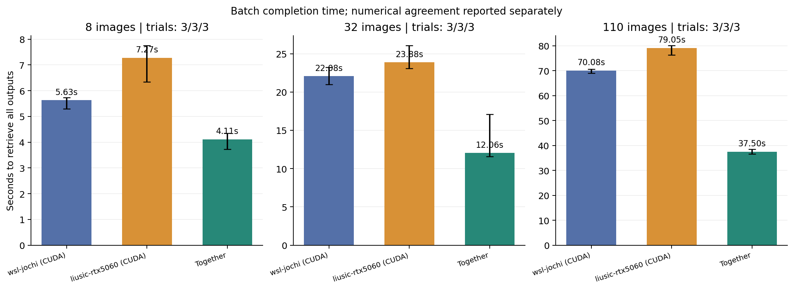
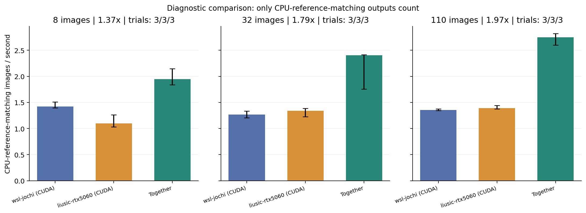

# Infer 单机与双机对照报告

来源运行：`diagnostic-auto-infer-20261114-224617-243421`。

最大实测批次 110 张：jochi、liusic、两台共同处理的整批耗时中位数分别为 **70.08、79.05、37.50 秒**，双机相对耗时较短的单机减少 46.48%。这里统计取得全部输出的时间；输出是否通过数值参考需结合下文通过率判断。

已保存 27/27 轮正式测量，返回 1350 个输出，其中 **1260/1350** 个通过固定 CPU 数值参考校验。
另有 304/304 个冒烟和预热输出通过同一数值校验。
固定 110 张测量图片，以嵌套的 8、32、110 张子集复用；输出数包含跨轮重复，不是不同原图数。

**本报告是诊断性对照，数值一致性尚未全部通过，不能作为完整正确性验收或无条件加速宣传。**

本实验跨网络中断分段完成。恢复前重验原有证据与设备配置，重新冒烟和预热；中断轮次的旧计时不纳入，旧任务先查询并取回结果，再补做该轮。恢复记录及排除证据保留在 continuations 中。

另独立复核 4 个恢复/排除作业，134/134 个输出通过数值参考；这些输出与旧计时均不计入正式吞吐。

single-1：wsl-jochi (CUDA)；single-2：liusic-rtx5060 (CUDA)。

| 图片数 | 单机 1 张/秒 | 单机 2 张/秒 | 一起跑 张/秒 | 相对最快单机 | 两台均参与的 pool 轮次 |
| ---: | ---: | ---: | ---: | ---: | ---: |
| 8 | 1.4211 | 1.0997 | 1.9451 | +36.87% | 3/3 |
| 32 | 1.2680 | 1.3400 | 2.4049 | +79.47% | 3/3 |
| 110 | 1.3556 | 1.3915 | 2.7463 | +97.36% | 3/3 |

吞吐只计通过数值校验的输出，未通过项计为零有效工作；耗时保留整轮全部执行时间。
两台贡献统计也是有效输出贡献。原始返回贡献单列在 JSON 的 returned_per_worker 中。

| 图片数 | 条件 | 已保存轮数 | CPU 参考通过 / 总数 | 整轮耗时中位数（秒） |
| ---: | --- | ---: | ---: | ---: |
| 8 | single-1 | 3 | 24/24 | 5.630 |
| 8 | single-2 | 3 | 24/24 | 7.275 |
| 8 | pool | 3 | 24/24 | 4.113 |
| 32 | single-1 | 3 | 84/96 | 22.082 |
| 32 | single-2 | 3 | 96/96 | 23.881 |
| 32 | pool | 3 | 87/96 | 12.059 |
| 110 | single-1 | 3 | 285/330 | 70.079 |
| 110 | single-2 | 3 | 330/330 | 79.051 |
| 110 | pool | 3 | 306/330 | 37.505 |

图表使用已保存轮次的中位数，具体轮数见表及图；误差线为最小至最大值，不是置信区间。只有一轮的值没有重复性证据。
计时口径：`verified images / registered-dataset job submit-to-result-download time; initial registration excluded`。本地 CPU 参考生成和结果数值校验不计时。
速度是两台电脑及其部署、网络、Coordinator 的整体服务表现。未达到双机加速的规模也保留，不挑选最好一轮。
各自吞吐之和仅是经验参照，不能解释为调度的理论最优上界。

## 数值差异分布

| Worker | 返回输出 | 通过 CPU 参考 | 未通过 | 涉及不同输入数 |
| --- | ---: | ---: | ---: | ---: |
| wsl-jochi | 690 | 600 | 90 | 15 |
| liusic-rtx5060 | 660 | 660 | 0 | 0 |

未通过数是跨轮输出数，不能等同于不同原图数；具体图片列表见精简证据。输出未满足固定数值容差不直接等同于模型语义判断错误，也不自动视为无害。

## 复现与有效性

本次测试客户端提交为 `192319c9011b8cd1abf16537c26d76fadf7ad76a`。发布报告时，上游已包含 [CUDA 精度修复 6f0bf1e](https://github.com/huaruoji/campus-edge-fabric/commit/6f0bf1e02c861e44585b243d5f0abb6adbcd435c)，将 CUDA provider 的 `use_tf32` 设为 0 并返回 provider options。本报告保留本次实际结果，未对该修复另行重跑，也未取得远端部署提交证明；不能据此认定最新版本仍有相同差异，或修复已经通过实机验收。

输入为固定 COCO128 子集，每张不超过 500,000 字节；同一规模三条件输入相同。
模型为固定 YOLO11n，imgsz=640，conf=0.25，max_det=100。冒烟与预热图片和正式集互不重叠。
每个正式条件前预热；双机条件先分别预热两台。规模和条件顺序按重复轮换。
复核所有结果 ZIP 的完整性、文件哈希、任务/输入/Worker 对应关系、逐份 CPU/CUDA 后端和数值参考。
置信度容差 0.002、框坐标容差 0.3 像素，检测数量与类别一致；这不代表 mAP 或泛化精度。
输出 provider 和能力自报不能代替远端算子跟踪；物理设备身份、完整硬件和部署提交需由设备操作者补充。
资源点来自整机心跳，可能包含其他程序，短作业采样有限；缺失值没有按零填补。

正式轮次最终 attempt 中的重试合计：0。
详细时间、设备配置和资源摘要见 [精简证据](evidence.json)。原图、模型、原始 ZIP 留在本地。

## 服务开销观察

下表保留 110 张共同运行时的服务端作业窗口、适配器处理时间之和与整机 GPU 心跳均值。处理时间之和不是并行执行墙钟，资源均值也不是本进程的专属占用。

| pool 轮次 | 服务端秒 | 适配器时间之和（秒） | jochi GPU 心跳均值 / 点数 | liusic GPU 心跳均值 / 点数 |
| --- | ---: | ---: | --- | --- |
| r1-n110-pool | 35.466 | 7.516 | 6.86% / 7 | 3.57% / 7 |
| r2-n110-pool | 37.737 | 7.303 | 7.14% / 7 | 9.86% / 7 |
| r3-n110-pool | 36.694 | 6.023 | 13.86% / 7 | 0.29% / 7 |

这些观察只能说明应继续细分领取任务、输入传输、推理、结果上传与服务端处理等阶段，不能将全部差额归为网络耗时或把本次收益解释成 GPU 已充分利用。

## 正式轮次

| 轮次 | Job ID | 端到端秒 | 单机 1 / 单机 2 有效输出 |
| --- | --- | ---: | ---: |
| r1-n8-single-1 | `job_01M7D8CT9T6QF7YRCP5B3A4X3V` | 5.736 | 8 / 0 |
| r1-n8-single-2 | `job_01M7D8D992XK2PWC4QEVMPE6WA` | 6.336 | 0 / 8 |
| r1-n8-pool | `job_01M7D8E1ESN3WJB2VTCV7FJWKQ` | 3.729 | 4 / 4 |
| r1-n32-single-1 | `job_01M7D8ECFNNP9QWDR78HCBCRMH` | 20.967 | 28 / 0 |
| r1-n32-single-2 | `job_01M7D8FB1T04YWBYKVXS87J6PX` | 23.881 | 0 / 32 |
| r1-n32-pool | `job_01M7D8GHR93A8Z7BABHWYXEEG8` | 17.095 | 22 / 8 |
| r1-n110-single-1 | `job_01M7D8HBB26D83T1RPBFAQSR37` | 70.590 | 95 / 0 |
| r1-n110-single-2 | `job_01M7D8KS6D0XP2NF0J8K2W8H8F` | 76.272 | 0 / 110 |
| r1-n110-pool | `job_01M7D8VBXQNKG19JV6ZTCN7JXY` | 36.546 | 50 / 53 |
| r2-n32-single-2 | `job_01M7D8WSBWKFFN9Q36X6FBWQGV` | 26.052 | 0 / 32 |
| r2-n32-pool | `job_01M7D8Y472FZ5H6GRNNKN51MK1` | 11.597 | 14 / 14 |
| r2-n32-single-1 | `job_01M7D8YPS6GXA4M6HDTZ0E0XXF` | 22.082 | 28 / 0 |
| r2-n110-single-2 | `job_01M7DA6KVJ5QW533BBE78VC3KC` | 80.069 | 0 / 110 |
| r2-n110-pool | `job_01M7DA9K1D1RJ839KJ7N4BJ4N1` | 38.465 | 46 / 54 |
| r2-n110-single-1 | `job_01M7DAAZPVYKBFXJ7T60MV4H6Z` | 70.079 | 95 / 0 |
| r2-n8-single-2 | `job_01M7DADDKFFJHDC2QSWFWK9WA3` | 7.748 | 0 / 8 |
| r2-n8-pool | `job_01M7DAE58NPXCNP8M858WYMVHJ` | 4.113 | 4 / 4 |
| r2-n8-single-1 | `job_01M7DAEHAWRMZ5VNPJ1JQNAPP0` | 5.630 | 8 / 0 |
| r3-n110-pool | `job_01M7DAF6M1CT784B7D4CNMY9TZ` | 37.505 | 49 / 54 |
| r3-n110-single-1 | `job_01M7DAGK5WRP31MTFFBNRJDMRE` | 69.002 | 95 / 0 |
| r3-n110-single-2 | `job_01M7DAK00DXB6AH30NRWZXX6HQ` | 79.051 | 0 / 110 |
| r3-n8-pool | `job_01M7DANXTJCR3J17081Y1Y9F5J` | 4.348 | 4 / 4 |
| r3-n8-single-1 | `job_01M7DAP918ZB4AKN89830JYYXP` | 5.299 | 8 / 0 |
| r3-n8-single-2 | `job_01M7DAPQ09AAQPZF8NA8EN8QXE` | 7.275 | 0 / 8 |
| r3-n32-pool | `job_01M7DAQDXEC45YTGM28VQCHM18` | 12.059 | 14 / 15 |
| r3-n32-single-1 | `job_01M7DAR2C8N315B04W51Z642GN` | 23.228 | 28 / 0 |
| r3-n32-single-2 | `job_01M7DAS3PXSSFSEKED4EDPXASJ` | 23.094 | 0 / 32 |
